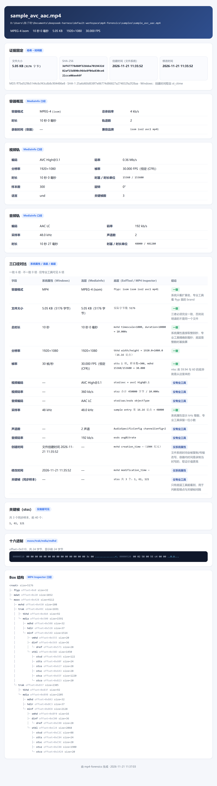
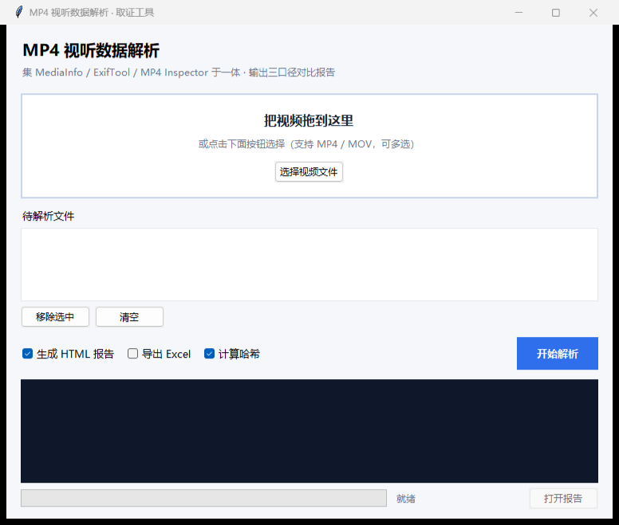

# mp4-forensics

一个工具替代实验里那四套软件——**MediaInfo + ExifToolGui + MP4 Inspector + Windows 属性**——并把它们的解析结果放进同一张“三口径对比表”，自动标出**一致 / 不一致 / 仅某层可见**。

纯 Python 标准库实现，**不依赖 ffmpeg、不依赖任何 GUI**；box 解析全程 64 位整数，直接规避 MP4 Inspector 0.1.2 在 4K 60fps 大文件上的整型溢出崩溃。



## 下载即用（Windows，不用装 Python）

**→ [下载 MP4取证工具 v1.0.0（20 MB）](https://github.com/fuzhouruoqi-netizen/mp4-forensics/releases/latest)**

1. 解压 zip（整个文件夹，`_internal` 要和 exe 放一起）
2. 双击 `MP4取证工具.exe`
3. 把视频拖进窗口 → 点「开始解析」
4. 自动打开报告，文件生成在视频旁边：`视频名_报告.html`



纯本地运行、不联网；支持 MP4 / MOV，可批量拖多个。

> 第一次运行 Windows 可能提示"已保护你的电脑"——打包程序没有代码签名，点「更多信息 → 仍要运行」即可。

## 对应关系

| 原软件 | 用来做什么 | 本工具对应 |
|---|---|---|
| **Windows 属性** | 时长、分辨率、帧率、采样率、文件大小（取整、字段少） | `三口径对比` 里的「系统属性」列 |
| **MediaInfo** | 容器/流参数：编码、码率、帧率、采样率、声道、色彩 | `info` 的容器/视频轨/音频轨，`--html` 报告 |
| **ExifToolGui** | 文件系统时间戳 + 底层标签（CreateDate、TimeScale、Duration） | `文件` 段（创建/修改/访问 + MD5/SHA1/SHA256）、`mvhd/mdhd` 原始值 |
| **MP4 Inspector** | box 结构树、ftyp/moov/mdat 位置、mdhd 原始值、十六进制 | `tree` / `hex` / 报告里的「Box 结构」「十六进制」 |

同一份数据在四种口径下**必然存在差异**：系统属性取整、MediaInfo 精确到毫秒、底层是整数时基。工具不替你“统一”这些数值，而是把差异**显式列出来**——这正是法庭数据检验需要固定下来的东西。

## 安装

```bash
git clone <this-repo>
cd mp4-forensics
python -m pip install -e .          # 可选：安装后可直接用 mp4-forensics 命令
```

要求 Python 3.9+，无第三方运行时依赖（导出 Excel 才需要 `openpyxl`）。

## Windows 最简单用法：拖拽

不用记命令：

1. 把仓库下载到本地（`git clone` 或页面上的 **Download ZIP** 解压）
2. 打开 `mp4-forensics` 文件夹，把**视频文件直接拖到 `解析视频.bat` 上**
3. 浏览器自动打开生成的报告，报告就在视频旁边：`视频名_report.html`

黑色窗口里会同时打印完整解析结果。只想看命令行也行，见下面。

> 没装 Python 会提示去 python.org 下载，安装时记得勾选 **Add python.exe to PATH**。

## 用法

### 1. 一次性看全（终端）

```bash
python -m mp4forensics info 视频.mp4
```

### 2. 生成 HTML 报告（推荐，可直接贴进实验报告）

```bash
python -m mp4forensics info 视频.mp4 --html report.html
```

报告包含：证据固定（哈希/时间戳）、容器概览、视频轨、音频轨、**三口径对比表**、关键帧列表、box 结构树，可选十六进制。

### 3. 只导出数据

```bash
python -m mp4forensics info 视频.mp4 --json data.json --xlsx 对比表.xlsx
```

### 4. 看 box 树 / 十六进制（替代 MP4 Inspector）

```bash
python -m mp4forensics tree 视频.mp4 --depth 6
python -m mp4forensics hex  视频.mp4 --box moov/trak/mdia/mdhd --length 256
```

### 5. 批量对比（对应实验里的视频1/2/3 横向比较）

```bash
python -m mp4forensics batch ./videos --html compare.html
```

### 6. 只算哈希（证据固定第一步）

```bash
python -m mp4forensics hash 视频.mp4
```

## 输出示例

```
容器
  格式               MPEG-4 (isom)
  时长               10 秒 0 毫秒  (10.000s)
  总体码率             4 kb/s
  录制时间             2026-09-21 08:30:08
  轨道数              2

视频轨 #1
  编码               AVC High@3.1
  分辨率              3840×2160
  帧率               59.940 FPS（恒定 (CFR)）
  码率               54.50 Mb/s
  时长               8 秒 819 毫秒 (mdhd 8819/1000)
  样本数              528
  关键帧              2 个，前 10: 1, 61

三口径对比
  一致 6 · 不一致 2 · 仅专业工具 6

  字段            系统属性                      流层                        结论
──────────────────────────────────────────────────────────────────────────
  总时长           8 秒                       8 秒 819 毫秒                 不一致
  帧率            60 帧/秒                    59.940 FPS（恒定 (CFR)）      不一致
  视频编码          —                         AVC High@3.1                仅专业工具
```

## 它比原软件多做了几件事

1. **时间戳交叉验证**：文件系统创建时间 vs 容器内 `mvhd creation_time`，两者不一致会标红（复制、转存、剪辑的典型痕迹）。
2. **时基换算可追溯**：每个时长都给出 `timescale / duration` 原始整数，报告里能直接复算，不怕“软件算错”。
3. **关键帧（stss）可视化**：剪辑点、I 帧间隔，原报告里要手动翻 box 才能看到。
4. **大文件不炸**：`size==1` 的 64 位 box、4GB+ 偏移、变长 `stsz` 分块读取，都有针对性处理与单元测试。
5. **可复现**：同一输入 → 同一哈希 → 同一份 JSON/HTML，比截图更适合作为检材记录。

## 目录结构

```
mp4-forensics/
├── mp4forensics/
│   ├── boxes.py       # box 递归解析（64 位安全、流式、容错）
│   ├── media.py       # 从 box 提取元数据（mvhd/tkhd/mdhd/stsd/stts/stsz/stss/esds/avcC）
│   ├── system.py      # 文件系统时间戳 + 哈希
│   ├── compare.py     # 三口径对比与差异判定
│   ├── report.py      # HTML / JSON / Excel 输出
│   └── cli.py         # 命令行
├── tests/
│   ├── build_sample.py  # 用 struct 现场拼一个 H.264 + AAC 的 MP4
│   └── test_mp4.py      # 14 项单元测试
└── samples/             # 演示报告
```

## 测试

```bash
python -m unittest discover -s tests -t . -v
```

覆盖：box 树、64 位 largesize、截断文件容错、AVC/AAC 解析、时基换算、三口径判定、HTML/JSON 输出。

## 已知限制

- 只解析 MP4/MOV 系（ISO BMFF）；MKV/AVI 不支持。
- 加密（`encv`/`enca`）与分片 MP4（`moof`/`traf`）能看结构，但样本表解析不完整。
- `--xlsx` 依赖 openpyxl，未安装则自动跳过。
- 不提取缩略图/色彩信息（`colr`、HDR 元数据），后续可加。

## License

MIT
